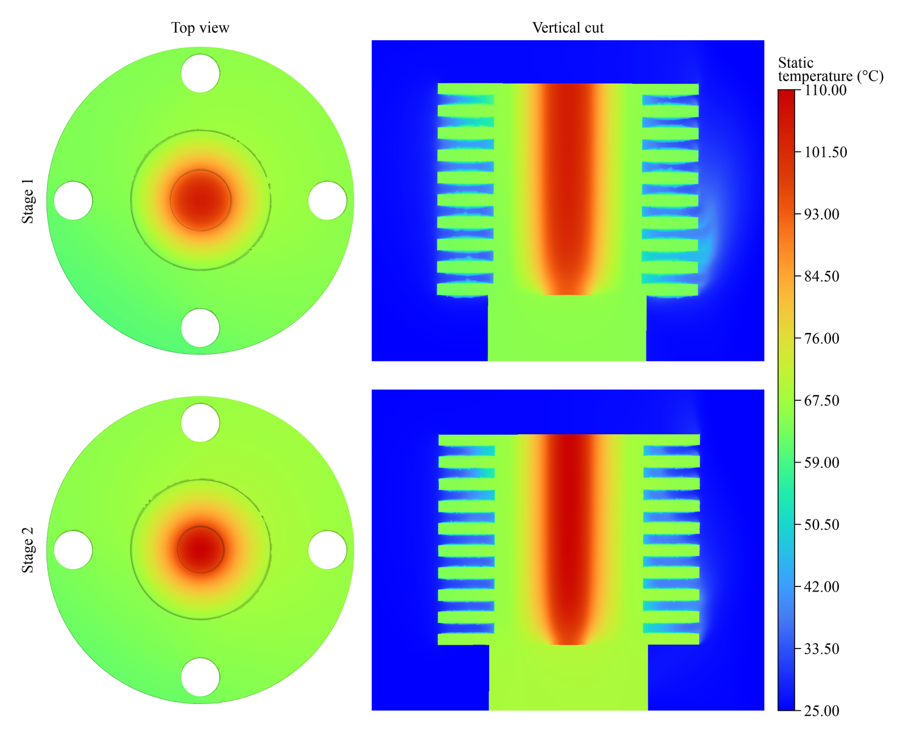
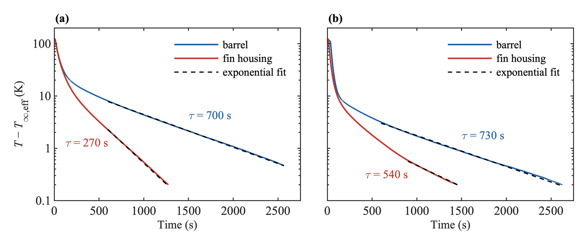
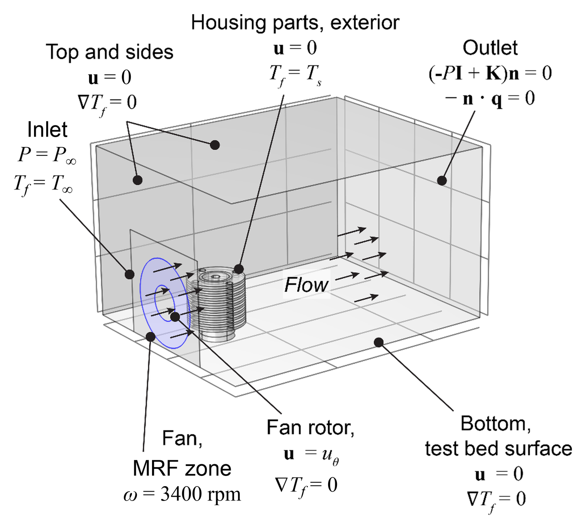
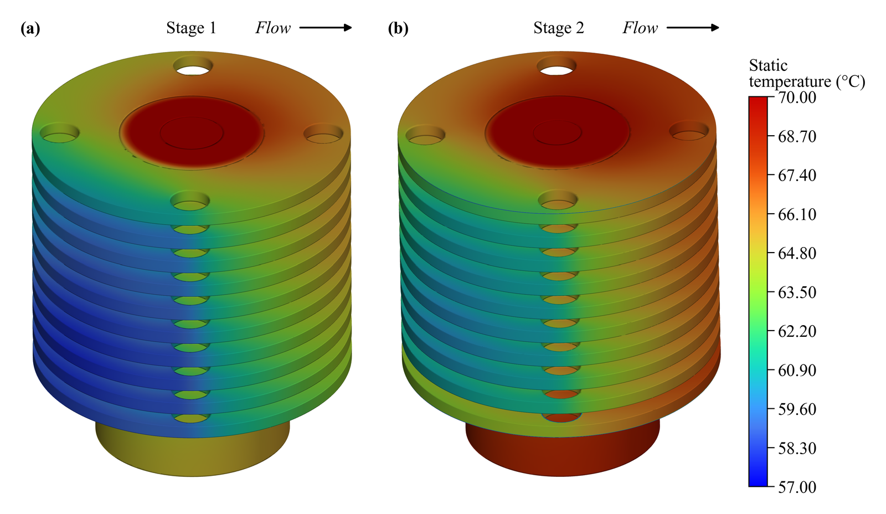
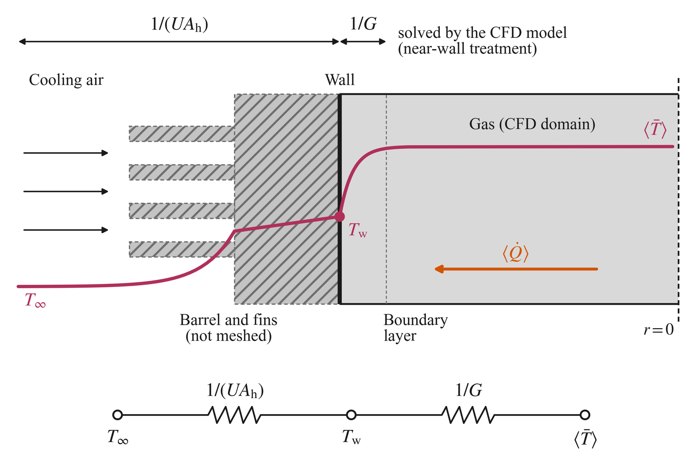

# Compressor heat transfer

*Experimental and computational investigation of external heat loss on the piston housing of a
high-pressure reciprocating compressor.*

How heat leaves the cylinders of a high-pressure reciprocating nitrogen booster (40 to 140 bar,
75 rpm), and how to represent that path in a 0-D model and a transient 3-D CFD model. Cool-down
experiments show that one constant overall heat transfer coefficient U is a valid boundary
condition, and steady conjugate CFD of each finned housing in the fan stream gives its value. The
work began in my MSc thesis at the Middle East Technical University (2026), in collaboration with
Logos Kimya on their YB690 booster.

## Introduction

<p align="center">
  
  <br><em>Steady conjugate CFD of the stage-1 (top) and stage-2 (bottom) housings; air flows from left to right.</em>
</p>

Compression heats the gas and re-expansion of the clearance gas cools it: in the 3-D CFD the
volume-averaged gas temperature swings from about -9 °C to about 104 °C every cycle. The wall heat
transfer also sets the delivered flow. A larger U warms the residual gas, which then re-expands
over more of the stroke and opens the suction valve later, so the 0-D model predicts less flow at
higher U. The heat crosses the gas-side boundary layer, a 316 stainless steel barrel, a finned 6061
aluminium jacket and the fan-driven air at 25 °C. Neither compressor model meshes the housing, so
the question is how to put that path into them.

## How it fits

This page is one piece of the [Reciprocating compressor CFD](https://github.com/astralisxx/reciprocating-compressor-cfd) work:

- The overall heat transfer coefficient from the housing CFD is the wall heat-loss input of the 0-D
  compressor models and of the [LOGOS-YB690 Booster](https://github.com/astralisxx/logos-yb690-booster)
  simulator.
- The series wall condition described below is the thermal boundary of the transient 3-D compressor
  CFD.
- Heat exchange with the wall changes how much residual gas re-expands, and so the delivered flow.
  Together with the valve characterisation in [High-pressure check valves](https://github.com/astralisxx/check-valve-cfd),
  it is one of the two inputs that control what the compressor models predict.

## What I did

- **Cool-down experiments** on a test bed: an oven-heated stainless steel test cylinder placed in
  each housing and cooled by the compressor's own fan, for the cylinder alone, the barrel and the
  full finned housing, followed by a lumped-capacitance and quasi-steady analysis of the records.
- **Steady conjugate CFD of each finned housing** in the fan stream: the fan as a rotor in a
  multiple reference frame zone, k-epsilon turbulence with scalable wall functions, conduction in
  cylinder, barrel and fins coupled to the air, and a volumetric heat source in the cylinder.
  About 29 million cells; energy balance closed within 0.2 %.
- **Conversion to an overall coefficient**: each housing's conductance UA becomes the U of that
  stage in the 0-D model.
- **A series wall condition for the transient 3-D compressor CFD**: the gas-side boundary layer is
  resolved with the k-omega SST near-wall treatment, and the unmeshed housing acts through an
  isothermal wall temperature that is updated once per cycle.
- **Separation of the gas-side and housing resistances** from a fit of the CFD wall heat flow.

## Results

**One constant U is valid cycle by cycle.** The fitted time constants are hundreds of times longer
than the crank cycle, so the housing sees only the cycle-mean heat load.

<p align="center">
  
  <br><em>Cool-down of the barrel and the fin housing, stage 1 (a) and stage 2 (b), with exponential fits.</em>
</p>

**The housing CFD gives U per stage.** Since the housing responds only to the cycle-mean load, it
is simulated in steady state. With constant properties the problem is linear in the temperature
difference, so UA does not depend on the source strength.

<p align="center">
  
  <br><em>Domain and boundary conditions of the housing CFD, with the fan as a rotating zone (not to scale).</em>
</p>

| Stage | U (W/(m²·K)) |
|---|---|
| 1 | 640 |
| 2 | 770 |

<p align="center">
  
  <br><em>Outer surface temperature of the stage-1 (a) and stage-2 (b) housings on a common scale.</em>
</p>

**The gas-side boundary layer carries most of the resistance.** A least-squares fit of the 3-D CFD wall heat flow over the last cycle gives an effective
gas-to-surroundings coefficient of 172 W/(m²·K):

```
1/U_eff = 1/U_gas + 1/U_housing          (both on the gas-side wall area)
gas-side share = 1 - U_eff/U_housing = 1 - 172/640 = 0.73
```

<p align="center">
  
  <br><em>Wall condition of the 3-D CFD: the solved gas side in series with the unmeshed barrel, fins and air.</em>
</p>

## Conclusions

- One constant U per stage is a valid wall condition: the housing behaves as a lumped body (Bi about 0.05) and responds only to the cycle-mean heat load.
- Cool-down fits shift U two- to more than tenfold with the fit window, so U comes from the conjugate housing CFD: 640 W/(m²·K) for stage 1, 770 for stage 2.
- In the 3-D compressor CFD the gas-side boundary layer, not the housing, limits the heat loss, carrying about three quarters of the total thermal resistance.
- Cooling changes the delivered flow: with both fans off, the measured flow in one test rose by about 20 %, the direction the 0-D model predicts for a lower U.
- Predicted flow is most sensitive to U at high pressure ratio: raising U from 100 to 700 W/(m²·K) cuts it by 43 % at a ratio of 4.4 but only 2 % at 2.0.

## Limits

- The housing CFD neglects radiation and the temperature dependence of the properties. The
  linearity that makes UA independent of the heat load holds only under these assumptions.
- A constant U is an assumption, justified by the quasi-steady check of the cool-down records.
- The cool-down records give the validity of a constant U, not its value. Their ln(theta) has no
  linear region (the parts are still equalising early, the curve bends toward the asymptote late),
  so the value comes from the housing CFD.

## Related work

Part of my MSc thesis (METU, 2026; Chapter 5) and of a journal manuscript in preparation. Sibling pages:
[Reciprocating compressor CFD](https://github.com/astralisxx/reciprocating-compressor-cfd) ·
[High-pressure check valves](https://github.com/astralisxx/check-valve-cfd) ·
[LOGOS-YB690 Booster](https://github.com/astralisxx/logos-yb690-booster).

<details>
<summary>Publications</summary>

- A. B. Şimşek, B. Erdoğan, N. B. Üner, "Computational Design of a High-Pressure Compressor and Its
  Experimental Validation", ICCHMT 2025, Lecture Notes in Mechanical Engineering, Springer,
  pp. 390-399, 2026. https://doi.org/10.1007/978-3-032-16138-3_36 (the earlier 2-D CFD model,
  with adiabatic walls).
- F. Turgut, A. B. Şimşek, N. B. Üner, B. Erdoğan, "Analysis of a High-Pressure Reciprocating
  Compressor Piston's 2D Simulation Utilizing Computational Fluid Dynamics", ICBASET 2024, The
  Eurasia Proceedings of Science, Technology, Engineering and Mathematics, vol. 28, pp. 352-359,
  2024. https://doi.org/10.55549/epstem.1523562
- MSc thesis: "Experimental and Numerical Design of a High-Pressure Reciprocating Compressor",
  METU, 2026. Chapter 5 covers the housing heat transfer.
- A journal manuscript on the 0-D and 3-D CFD models and their validation is in preparation; the
  wall condition described here is part of it.

</details>

## Source and copyright

This repository holds only this page and its figures. The Fluent cases, the user-defined functions,
the MATLAB models and the measured data are private.

Copyright (c) 2026 Ahmet Berkay Şimşek. All rights reserved. The figures may not be reused without
permission.
